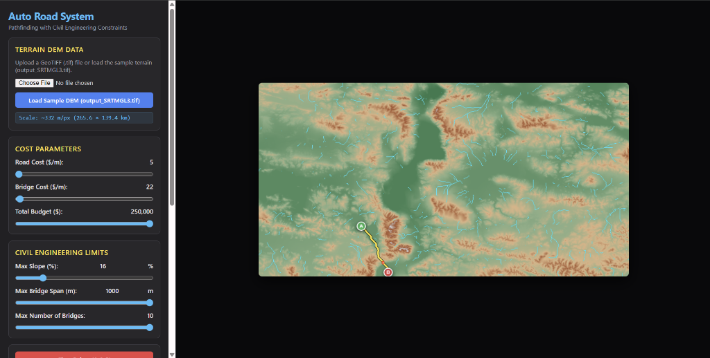
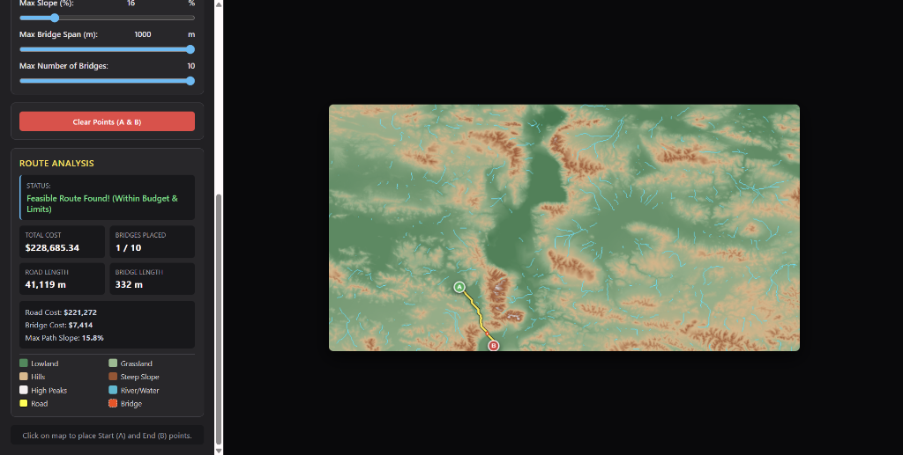
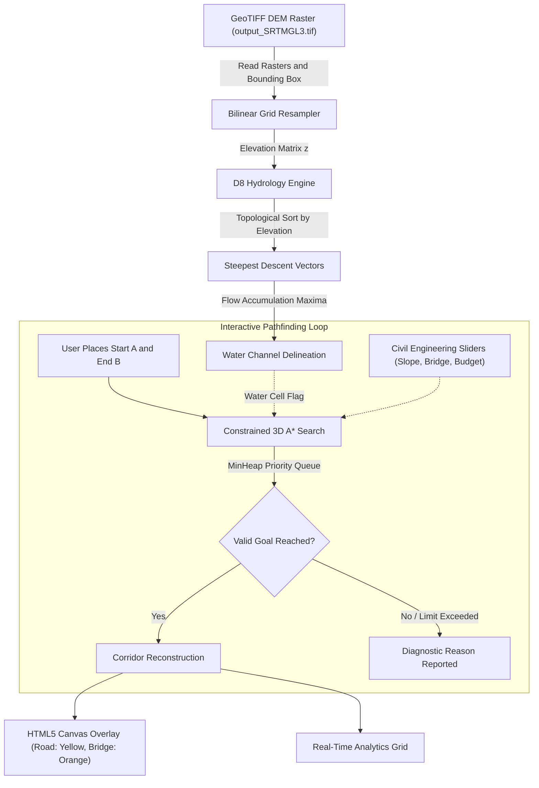

<div align="center">

# 🛣️ Auto Road Construction System
### *Autonomous Highway Alignment & Bridge Pathfinding Engine on Real-World GeoTIFF Topography*

[](https://www.iitmandi.ac.in)
[](https://opensource.org/licenses/MIT)
[](https://developer.mozilla.org/en-US/docs/Web/JavaScript)
[](https://developer.mozilla.org/en-US/docs/Web/API/Canvas_API)
[](https://www.usgs.gov/centers/eros/science/usgs-eros-archive-digital-elevation-shuttle-radar-topography-mission-srtm)
[](https://en.wikipedia.org/wiki/Flow_accumulation)
[](#)

<p align="center">
  <strong>An interactive civil engineering simulation that computes optimal, budget-conscious road corridors and bridge placements across mountainous terrain using real NASA/USGS Digital Elevation Models.</strong>
  <br/>
  <em>Developed as a Research Internship Project at the <strong>Indian Institute of Technology Mandi (IIT Mandi)</strong> under the guidance of <strong>Dr. Parimala Kancharla</strong> (School of Computing and Electrical Engineering).</em>
</p>

[Academic Affiliation](#️-academic--research-affiliation) • [Explore Features](#-key-features) • [System Architecture](#-system-architecture) • [Quick Start](#-quick-start) • [Controls Guide](#-control-parameters-guide)

</div>

---

## 🏛️ Academic & Research Affiliation

This project was researched and engineered during an official academic research internship at the **Indian Institute of Technology Mandi (IIT Mandi)**, Himachal Pradesh, India.

| Detail | Specification |
| :--- | :--- |
| **Project Title** | **Auto Road Construction Using Pathfinding Algorithms with Civil Engineering Constraints** |
| **Host Institution** | **Indian Institute of Technology Mandi (IIT Mandi)** |
| **Department** | School of Computing and Electrical Engineering (SCEE) |
| **Faculty Guide & Supervisor** | **Dr. Parimala Kancharla**, Assistant Professor, SCEE, IIT Mandi |
| **Student Researcher** | **D. Tejesh Kumar** (AI & Data Science, KLEF Hyderabad) |
| **Tenure** | December 1, 2024 – May 25, 2025 |
| **Certificate of Internship** | [View Verified PDF](./docs/IIT_Mandi_Internship_Certificate.pdf) |

<br/>

<div align="center">
  
  <p><em>Official Certificate of Internship issued by the Indian Institute of Technology Mandi</em></p>
</div>

---

## 📸 Visual Showcase

<div align="center">

### 🗺️ Full Corridor Alignment with Automated River Crossing

*Real-time path generation on Shuttle Radar Topography Mission (SRTM) DEM across steep ridges and water networks.*

<br/>

### 📊 Real-Time Civil Engineering & Cost Breakdown

*Detailed route feasibility validation, longitudinal grade tracking, bridge length limits, and capital expenditure breakdown.*

</div>

---

## 📖 Overview

In transportation infrastructure planning, selecting a highway corridor through rugged topography is a high-stakes, multi-objective optimization challenge. Engineers must balance:

* **Maximum longitudinal slope gradients** to ensure vehicular safety and regulatory compliance.
* **Cut-and-fill excavation costs** versus expensive **structural bridge spans**.
* **Hydrological constraints** such as river basin crossings and watershed drainage lines.
* **Horizontal curvature constraints** to prevent dangerously sharp angular deflections.
* **Strict capital expenditure (CapEx) budgets**.

**Auto Road Construction System** is a client-side geospatial web application that ingests authentic **GeoTIFF Digital Elevation Models (DEMs)**, simulates watershed hydrology using the **D8 flow accumulation algorithm**, and computes optimal 3D road alignments using a custom-constrained **A* pathfinding engine**.

---

## ✨ Key Features

- **🛰️ Authentic GeoTIFF DEM Ingestion**
  - Reads raw 16-bit / 32-bit floating-point elevation rasters (e.g. NASA SRTM 30m/90m).
  - Employs **bilinear interpolation** to resample arbitrary GeoTIFF dimensions onto an interactive HTML5 canvas.
  - Automatically parses geospatial bounding boxes (WGS84 degrees or UTM meters) to deduce real-world physical scale (meters per pixel).

- **🌊 D8 Hydrological Flow Simulation**
  - Sorts topographic nodes in descending order of elevation to guarantee strict upstream-to-downstream topological evaluation.
  - Computes steepest-descent flow direction vectors to model catchment drainage.
  - Accumulates runoff across millions of cells to delineate real stream networks, riverbeds, and wetlands.

- **🧗 3D Slope-Constrained A* Pathfinder**
  - Evaluates true 3D Euclidean distances and elevation differentials: $\Delta h = |z_2 - z_1|$.
  - Strictly prunes trajectories that exceed the user-defined **Maximum Slope Grade (%)**.
  - Applies directional curvature penalties to discourage sharp zig-zags and enforce civil engineering curvature standards.

- **🌉 Autonomous Bridge Deck Engineering**
  - Dynamically switches state between terrestrial road construction and elevated bridge deck construction upon crossing detected water bodies or deep depressions.
  - Enforces civil limits on **Maximum Single Span Length** and **Maximum Total Bridges** per corridor.
  - Applies realistic cost differentials ($C_{\text{bridge}} \gg C_{\text{road}}$).

- **💰 Real-Time Financial & Structural Metrics**
  - Live cost tracking against a user-configured budget ceiling.
  - Instantaneous feedback: Total Capital Cost, Road Length (m), Bridge Length (m), Max Corridor Slope (%) and Bridge Count.
  - Clear diagnostic alerts when routes fail due to slope walls, budget exhaustion, or bridge span limits.

- **🎨 Multi-Band Topographic Shading**
  - Dynamic colormap dividing terrain into Lowland (`#2E8B57`), Grassland (`#8FBC8F`), Hills (`#DEB887`), Steep Slope (`#A0522D`), High Peaks (`#F0F0F0`), and Active River Drainage (`#00BCD4`).

---

## 🏗️ System Architecture



---

## 🎛️ Control Parameters Guide

| Parameter | UI Control | Range | Engineering Rationale |
| :--- | :---: | :---: | :--- |
| **Road Cost ($/m)** | Slider | $5 - $100 | Standard ground clearing, grading, sub-base, and asphalt pavement unit cost. |
| **Bridge Cost ($/m)** | Slider | $20 - $300 | Elevated substructure, abutments, piers, and deck slab unit cost. |
| **Total Budget ($)** | Slider | $2,000 - $250,000 | CapEx ceiling. Terminate search if accumulated path cost exceeds budget. |
| **Max Slope (%)** | Slider | 5% - 65% | Highway design limit (typical highways restrict to 6% - 12%; mountain access roads to 15% - 25%). |
| **Max Bridge Span (m)** | Slider | 20m - 1000m | Maximum continuous structural span feasible without intermediate pylons. |
| **Max Number of Bridges**| Slider | 1 - 10 | Limit on structural crossing permits and complex engineering interventions. |

---

## 🚀 Quick Start

The application runs entirely in the browser with **zero dependencies or build tools** required.

### 1. Clone the Repository
```bash
git clone https://github.com/tejeshk05/VR_Road_Web_Prototype.git
cd VR_Road_Web_Prototype
```

### 2. Launch Local HTTP Server
Because modern browsers restrict reading local binary GeoTIFF files over the `file://` protocol via `fetch()`, run any lightweight static server:

#### Using Python (Recommended):
```bash
python -m http.server 8000
```
Open **[http://localhost:8000](http://localhost:8000)** in your browser.

#### Using Node.js:
```bash
npx serve .
```

#### Using VS Code:
Right-click `index.html` and select **"Open with Live Server"**.

---

## 🎮 How to Use

1. **Load DEM Data**:
   - Click **"Load Sample DEM (output_SRTMGL3.tif)"** to load the included mountainous terrain dataset, or upload your own `.tif` / `.tiff` elevation raster.
2. **Set Parameters**:
   - Adjust the **Max Slope (%)**, **Budget ($)**, and **Bridge Costs** to match your project specifications.
3. **Place Waypoints**:
   - Click anywhere on the map canvas to place **Start Point (A)** (green marker).
   - Click a second location to place **End Point (B)** (red marker).
4. **Inspect Route**:
   - The engine computes the alignment instantaneously.
   - Roads render as **Solid Yellow lines**; Bridges render as **Dashed Orange lines**.
   - Review total length, budget, slope distribution, and structural metrics in the **Route Analysis** panel.

---

## 📁 Repository Structure

```text
VR_Road_Web_Prototype/
├── docs/
│   ├── screenshots/
│   │   ├── route_overview.png                # Full route visualization across mountain terrain
│   │   └── route_analysis.png                # Metric dashboard & civil feasibility results
│   ├── IIT_Mandi_Internship_Certificate.pdf  # Verified IIT Mandi internship certificate
│   └── IIT_Mandi_Internship_Certificate.png  # Certificate document preview
├── app.js                                    # Application controller, canvas events, UI bindings
├── astar.js                                  # 3D A* pathfinder with slope, bridge & curvature limits
├── terrain.js                                # GeoTIFF bilinear interpolator & D8 hydrology simulation
├── style.css                                 # Modern dark-mode UI styling & responsive layout
├── index.html                                # Semantic HTML5 layout, controls, canvas viewport
├── output_SRTMGL3.tif                        # Sample 6.6MB SRTM Digital Elevation Model
├── .gitignore                                # Git ignore rules for clean repo maintenance
├── LICENSE                                   # MIT Open Source License
└── README.md                                 # Comprehensive project documentation
```

---

## 📜 License

This project is licensed under the [MIT License](LICENSE) - see the LICENSE file for details.

---

## 👨‍💻 Author & Acknowledgments

**D. Tejesh Kumar**  
*Department of Artificial Intelligence & Data Science, Koneru Lakshmaiah Education Foundation (KLEF), Hyderabad*  
- GitHub: [@tejeshk05](https://github.com/tejeshk05)  
- Email: [dtejeshk@gmail.com](mailto:dtejeshk@gmail.com)

### 🎓 Academic Mentorship & Supervision
Special thanks and sincere gratitude to **Dr. Parimala Kancharla** (Assistant Professor, School of Computing and Electrical Engineering, Indian Institute of Technology Mandi) for mentorship, research guidance, and domain supervision throughout this project.

---

<div align="center">
  <sub>Researched at Indian Institute of Technology Mandi (IIT Mandi) • Built with JavaScript, HTML5 Canvas, and Geospatial Data.</sub>
</div>
